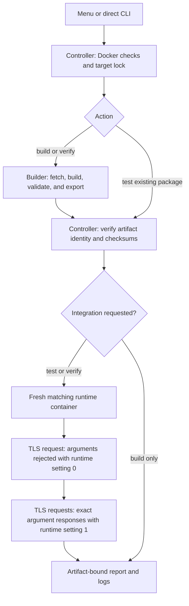

# nrpe-custom

Build and test custom NRPE packages for Debian and SUSE Linux Enterprise Server
(SLES). Use a keyboard-driven menu or scriptable CLI to rebuild distribution
packages with command argument support, then verify the result in an isolated
container.

**Argument support is compiled in, but remains disabled at runtime by default.**
Enabling it on a server is an explicit administrator decision. Bash command
substitution stays disabled.

This is an independent project. Its packages are unofficial custom builds, not
releases supported or certified by Debian, SUSE, or Nagios. Successful master
pushes publish [verified package releases](docs/releases.md); remaining work and
release evidence are tracked in the [release plan](docs/release-plan.md). Independently
authored project code and documentation are [MIT licensed](LICENSE); generated
packages retain their [upstream and distribution licenses](THIRD_PARTY.md).

## Warranty and responsibility

This software and its generated packages are provided **"AS IS", without
warranty**, including any warranty of fitness for a particular purpose, security,
availability, or uninterrupted operation. Use them at your own risk. To the
extent permitted by applicable law, the authors and contributors are not liable
for losses or damage arising from their use, including data loss, service
interruptions, or systems becoming unavailable or unresponsive. This notice does
not exclude liability that cannot lawfully be excluded. See the [MIT license](LICENSE)
and the applicable third-party license terms.

The source code and build recipes are available for inspection and independent
compilation. No malicious functionality is intended or knowingly included;
this is not a guarantee that the project, its dependencies, or generated packages
are free of defects or vulnerabilities. Review and test the software in your
environment, retain backups, and plan recovery before production deployment.
See [deployment security and limitations](docs/security.md).

## Quick start

Install Git, **Python 3.9+**, and Docker Engine with Linux containers, BuildKit,
and **Docker Compose 2.17+**. On Windows, start Docker Desktop and wait for its
Linux engine to become ready. Make sure `python3 --version` works in your shell.
ARM hosts need `linux/amd64` emulation. Allow disk space for separate builder and
test images; Docker's `vfs` storage driver can consume considerably more space.

```sh
git clone https://github.com/NoJokeFNA/nrpe-custom.git
cd nrpe-custom
python3 nrpe.py doctor
python3 nrpe.py verify debian12
```

This builds the package and tests its installation and NRPE argument handling.
Find packages in `output/<target>/` and run reports in `.nrpe/runs/<run-id>/`.
Builds and tests install packages inside containers, not on your workstation.

Prefer `nrpe.py`: it coordinates this project's Compose files, checks Docker,
protects targets against concurrent runs, and records logs and test results.

## Interactive menu

Install the optional menu dependencies in your Python environment:

```sh
python3 -m pip install -r requirements-menu.txt
python3 nrpe.py
```

Use **↑/↓ and Enter** to navigate, **Space** to toggle targets, **A** to select all,
and **Esc** to go back. Select build/test actions, diagnose Docker, inspect status,
or choose a previous run's logs. Select an optional company CA certificate
through its browser, or enter/paste its path directly.
The menu reviews your choices before running and returns after each command.
Colors highlight selection and errors; `NO_COLOR` enables monochrome output.
See [menu installation and controls](docs/menu.md), including virtual environments.

Direct commands do not require the menu dependencies. Without an interactive
terminal, launching without arguments prints help and never prompts.

The affected deployment is **SLES 12 SP3**, with old NRPE 2.15/OpenSSL 1.0.2.
The previous SLES-15 target was based on an incorrect platform assumption and
has been replaced. See the [SLES guide](docs/sles12sp3.md) and [FAQ](docs/faq.md)
for the native rebuild and TLS/service diagnosis.

## Supported targets

All package outputs target `linux/amd64` (`x86_64` for RPM).

| Target | Distribution | Package | Source policy |
| --- | --- | --- | --- |
| `debian11` | Debian 11 Bullseye | `nagios-nrpe-server` `.deb` | Discover through APT; archived security packages |
| `debian12` | Debian 12 Bookworm | `nagios-nrpe-server` `.deb` | Discover through APT |
| `debian13` | Debian 13 Trixie | `nagios-nrpe-server` `.deb` | Discover through APT |
| `debian14` | Debian 14 Forky | `nagios-nrpe-server` `.deb` | Discover through APT; moving testing suite |
| `sles12sp3` | SLES 12 SP3 | `nrpe` `.rpm` + companion user RPM | Reviewed, pinned OBS sources; genuine SLES base |

Target availability depends on distribution repositories and image availability.
A listed target is not a promise of ongoing upstream security maintenance. In
particular, historical archives do not extend a distribution's support period.
The SLES target uses a pinned genuine 12.3 image and verified original SLE-12
inputs; no ISO, SLE-15 packages or replacement distribution is used. Its native
build and certificate-authenticated TLS 1.2 integration passed locally on
2026-10-28. Container results do not establish production deployment readiness.
Use your run reports to identify the exact tested package bytes.

## Commands

| Command | Action |
| --- | --- |
| `python3 nrpe.py doctor` | Check project files, Docker, Linux containers, and Compose |
| `python3 nrpe.py verify debian12` | Build, validate, install, and integration-test |
| `python3 nrpe.py build debian12` | Build and validate the exported package |
| `python3 nrpe.py test debian12` | Install and test an existing local package |
| `python3 nrpe.py status` | Show artifacts, matching test results, and locks; no Docker needed |
| `python3 nrpe.py logs --last` | Show the most recent run's log |
| `python3 nrpe.py logs --run <id>` | Show a specific run's log |

Commands accept multiple targets or `all` by itself. `all` includes SLES.
Use `--help` or `<command> --help` for details.

Existing packages require confirmation before rebuilding. For automation, use
`--rebuild` explicitly. `--pull` checks for updated base images; it does not check
whether a built NRPE package is current. Debian source versions are discovered
when building; SLES sources stay pinned until reviewed and updated.

```sh
python3 nrpe.py verify debian12 debian13 --pull
python3 nrpe.py verify sles12sp3 --rebuild
python3 nrpe.py test debian11
```

For company HTTPS inspection, optionally select a local public CA certificate
(PEM or DER); TLS verification remains enabled:

```powershell
python3 nrpe.py verify sles12sp3 --ca-cert "C:\Certificates\Company-Root.cer"
```

No certificate is required by default or included in the exported NRPE package. See
[company CA setup and Docker trust limits](docs/network.md#optional-company-ca-certificate).

The compatibility entry point `build.py` still works. See the
[workflow reference](docs/workflow.md) for flags, outputs, caching, logs,
checksums, locks, and interruption handling.

## How it works



Each target has a builder image and a separate runtime test image. This prevents
compilers and build dependencies from masking missing runtime dependencies.
Docker reuses cached layers; images do not need to be recreated on every run.
The client is `check_nrpe`, as used by Nagios; a complete Nagios server is not
needed to test this protocol. Tests use TLS over loopback, publish no NRPE port,
and leave the packaged default configuration unchanged.

**Installation success alone does not prove argument handling works.** The test
must reject arguments with `dont_blame_nrpe=0`, then return exact results for two
different argument pairs with `dont_blame_nrpe=1`. Tests do not cover a full
systemd boot, production certificates, or external Nagios connectivity.

See [architecture and file responsibilities](docs/architecture.md) for the
component map and [network requirements](docs/network.md) for firewall planning.

## Using a built package

For NRPE installation concepts and server/client setup, consult the
[official NRPE documentation](https://github.com/NagiosEnterprises/nrpe) and
the [Nagios Core documentation](https://assets.nagios.com/downloads/nagioscore/docs/nagioscore/4/en/).
This project documents installing its custom distribution packages; it does not
provide a complete Nagios/NRPE deployment guide. Monitoring-server setup,
`check_nrpe`, plugin installation, check definitions, production TLS, and network
access must be configured for your environment using the upstream and
distribution documentation. Upstream source-install instructions describe an
alternative installation method; do not install over the custom package with
`make install`.

Follow the [installation guide](docs/installation.md) for step-by-step Debian
11–14 and SLES 12 SP3 instructions: which files to copy, checksum verification,
APT/zypper installation, the SLES companion user package, service startup, and
installed-version checks. Run installation commands on the destination server.
The guide also explains the unsigned custom RPMs and matching repository
requirements. See [SLES background](docs/sles12sp3.md) for source provenance and
historical repository availability.

Before changing an existing server, read [updates and rollback](docs/updates-and-rollback.md).
Use the [configuration examples](docs/configuration-examples.md) for fixed checks,
TLS settings and an optional restricted argument-profile wrapper. The
[support and maintenance policy](docs/maintenance.md) explains tested boundaries,
dependency monitoring and target deprecation.

Review the server's configuration before enabling arguments:

| Distribution | Configuration | Service |
| --- | --- | --- |
| Debian | `/etc/nagios/nrpe.cfg` | `nagios-nrpe-server` |
| SLES/OBS recipe | `/etc/nrpe.cfg` | `nrpe` |

```ini
allowed_hosts=<nagios-server-ip>,127.0.0.1,::1
dont_blame_nrpe=1
```

Replace the placeholder, define permitted commands with validated arguments,
configure trusted TLS certificates, and restrict the firewall to the intended
monitoring servers before restarting the service. Keep Bash command substitution
disabled. See [deployment security](docs/security.md).

## Development and project documentation

`master` is the default/release branch; `develop` is the integration branch.
Work on `feat/...`, `fix/...`, `refactor/...` or `remove/...` and open a PR into
`develop`. Never delete `master` or `develop`. See the [Git workflow](docs/git-workflow.md).
Successful master pushes build/test all five package targets and publish a
complete [release bundle](docs/releases.md); other branches do not publish.

GitHub Actions provides [Linux/Windows unit and configuration checks](https://github.com/NoJokeFNA/nrpe-custom/actions/workflows/checks.yml)
and a [scheduled Python dependency audit](https://github.com/NoJokeFNA/nrpe-custom/actions/workflows/dependency-audit.yml).
These checks do not replace package builds and runtime integration tests.

- [Menu guide](docs/menu.md): installation, keys, accessibility, and terminal behavior.
- [Workflow reference](docs/workflow.md): commands, artifacts, reports, and troubleshooting.
- [Installation guide](docs/installation.md): deploy custom Debian/SLES packages and configure services.
- [Updates and rollback](docs/updates-and-rollback.md): retain packages/configuration and recover deployments.
- [Configuration examples](docs/configuration-examples.md): fixed checks, TLS and restricted argument profiles.
- [Support and maintenance](docs/maintenance.md): verification boundaries, dependencies and source updates.
- [Container layout](docker/README.md): separate build/test recipes under `docker/`.
- [Git workflow](docs/git-workflow.md): human authorship, integration, promotion and guarded branch cleanup.
- [Release automation](docs/releases.md): per-master-push packages, sources, licenses and verification.
- [Architecture](docs/architecture.md): control flow and every script's purpose.
- [Network requirements](docs/network.md): domains, ports, directions, and proxy notes.
- [FAQ](docs/faq.md): Nagios/NRPE service startup and when a custom build is needed.
- [SLES 12 SP3](docs/sles12sp3.md): provenance, dependencies, build inputs, TLS 1.2 and installation.
- [SLES 12 SP3 handshake diagnostic](docs/sles12sp3-plaintext-diagnostic.md): anonymized temporary NRPE 2.15 plaintext test and cleanup, without changing the production service.
- [Contributing](CONTRIBUTING.md): development and meaningful validation.
- [Security](docs/security.md): argument risks and safe issue reporting.
- [Release and maintenance plan](docs/release-plan.md): open work and future release requirements.
- [Release history](docs/release-history.md): published versions and exact validation evidence.
- [Local cleanup](docs/local-cleanup.md): preview expired runs and explicitly selected retired outputs/images.
- [Troubleshooting](docs/troubleshooting.md): contextual build hints and read-only diagnosis of NRPE/server logs.
- [Documentation website](docs/website.md): local preview, field notes and reviewed publication to GitHub Pages.

These recipes provide a repeatable workflow, not a claim of bit-for-bit
reproducibility. Sources, image tags, and repositories can change. Review
upstream security updates and retain provenance with the artifacts you deploy.
