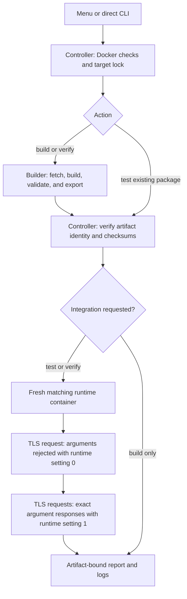

# nrpe-custom

Build and test custom NRPE packages for Debian and SUSE Linux Enterprise Server
(SLES). Use a keyboard-driven menu or scriptable CLI to rebuild distribution
packages with command argument support, then verify the result in an isolated
container.

**Argument support is compiled in, but remains disabled at runtime by default.**
Enabling it on a server is an explicit administrator decision. Bash command
substitution stays disabled.

This is an independent project. Its packages are unofficial custom builds, not
releases supported or certified by Debian, SUSE, or Nagios. Public binary release
preparation and the project's own license selection are
[deferred](docs/release-plan.md).

## Quick start

Install Git, **Python 3.9+**, and Docker Engine with Linux containers, BuildKit,
and **Docker Compose 2.17+**. On Windows, start Docker Desktop and wait for its
Linux engine to become ready. Make sure `python3 --version` works in your shell.
ARM hosts need `linux/amd64` emulation. Allow disk space for separate builder and
test images; Docker's `vfs` storage driver can consume considerably more space.

```sh
git clone https://github.com/NoJokeFNA/nrpe-custom.git
cd nrpe-custom
python3 nrpe.py doctor
python3 nrpe.py verify debian12
```

This builds the package and tests its installation and NRPE argument handling.
Find packages in `output/<target>/` and run reports in `.nrpe/runs/<run-id>/`.
Builds and tests install packages inside containers, not on your workstation.

Prefer `nrpe.py`: it coordinates this project's Compose files, checks Docker,
protects targets against concurrent runs, and records logs and test results.

## Interactive menu

Install the optional menu dependencies in your Python environment:

```sh
python3 -m pip install -r requirements-menu.txt
python3 nrpe.py
```

Use **↑/↓ and Enter** to navigate, **Space** to toggle targets, **A** to select all,
and **Esc** to go back. Select build/test actions, diagnose Docker, inspect status,
or choose a previous run's logs. Select SLES media and optional company CA
certificates through their browsers, or enter/paste a path directly.
The menu reviews your choices before running and returns after each command.
Colors highlight selection and errors; `NO_COLOR` enables monochrome output.
See [menu installation and controls](docs/menu.md), including virtual environments.

Direct commands do not require the menu dependencies. Without an interactive
terminal, launching without arguments prints help and never prompts.

## Supported targets

All package outputs target `linux/amd64` (`x86_64` for RPM).

| Target | Distribution | Package | Source policy |
| --- | --- | --- | --- |
| `debian11` | Debian 11 Bullseye | `nagios-nrpe-server` `.deb` | Discover through APT; archived security packages |
| `debian12` | Debian 12 Bookworm | `nagios-nrpe-server` `.deb` | Discover through APT |
| `debian13` | Debian 13 Trixie | `nagios-nrpe-server` `.deb` | Discover through APT |
| `debian14` | Debian 14 Forky | `nagios-nrpe-server` `.deb` | Discover through APT; moving testing suite |
| `sles15sp4` | SLES 15 SP4 | `nrpe` `.rpm` + companion user RPM | Reviewed, pinned OBS sources; genuine SLES base |

Target availability depends on distribution repositories and image availability.
A listed target is not a promise of ongoing upstream security maintenance. In
particular, historical archives do not extend a distribution's support period.
The SLES recipe uses SLE/Package Hub dependencies and no Leap replacement image
or repository. An installation ISO is optional; see [the SLES guide](docs/sles15sp4.md).

Debian 11 and SLES 15 SP4 passed build, fresh-container installation, and TLS
argument tests during initial validation. Use your own run reports to establish
which exact package bytes have passed; target support is not a passing test badge.

## Commands

| Command | Action |
| --- | --- |
| `python3 nrpe.py doctor` | Check project files, Docker, Linux containers, and Compose |
| `python3 nrpe.py verify debian12` | Build, validate, install, and integration-test |
| `python3 nrpe.py build debian12` | Build and validate the exported package |
| `python3 nrpe.py test debian12` | Install and test an existing local package |
| `python3 nrpe.py status` | Show artifacts, matching test results, and locks; no Docker needed |
| `python3 nrpe.py logs --last` | Show the most recent run's log |
| `python3 nrpe.py logs --run <id>` | Show a specific run's log |

Commands accept multiple targets or `all` by itself. `all` includes SLES.
Use `--help` or `<command> --help` for details.

Existing packages require confirmation before rebuilding. For automation, use
`--rebuild` explicitly. `--pull` checks for updated base images; it does not check
whether a built NRPE package is current. Debian source versions are discovered
when building; SLES sources stay pinned until reviewed and updated.

```sh
python3 nrpe.py verify debian12 debian13 --pull
python3 nrpe.py verify sles15sp4 --rebuild
python3 nrpe.py test debian11
```

For company HTTPS inspection, optionally select a local public CA certificate
(PEM or DER); TLS verification remains enabled:

```powershell
python3 nrpe.py verify sles15sp4 --ca-cert "C:\Certificates\Company-Root.cer"
```

No certificate is required by default or included in the exported NRPE package. See
[company CA setup and Docker trust limits](docs/network.md#optional-company-ca-certificate).

The compatibility entry point `build.py` still works. See the
[workflow reference](docs/workflow.md) for flags, outputs, caching, logs,
checksums, locks, and interruption handling.

## How it works



Each target has a builder image and a separate runtime test image. This prevents
compilers and build dependencies from masking missing runtime dependencies.
Docker reuses cached layers; images do not need to be recreated on every run.
The client is `check_nrpe`, as used by Nagios; a complete Nagios server is not
needed to test this protocol. Tests use TLS over loopback, publish no NRPE port,
and leave the packaged default configuration unchanged.

**Installation success alone does not prove argument handling works.** The test
must reject arguments with `dont_blame_nrpe=0`, then return exact results for two
different argument pairs with `dont_blame_nrpe=1`. Tests do not cover a full
systemd boot, production certificates, or external Nagios connectivity.

See [architecture and file responsibilities](docs/architecture.md) for the
component map and [network requirements](docs/network.md) for firewall planning.

## Using a built package

On Debian, copy the package to the matching server and install it with APT so
runtime dependencies are resolved:

```sh
sudo apt install ./nagios-nrpe-server_<version>_amd64.deb
```

For SLES, use the [SLES installation notes](docs/sles15sp4.md), including the
companion user package and the availability of historical repositories.

Review the server's configuration before enabling arguments:

| Distribution | Configuration | Service |
| --- | --- | --- |
| Debian | `/etc/nagios/nrpe.cfg` | `nagios-nrpe-server` |
| SLES/OBS recipe | `/etc/nrpe.cfg` | `nrpe` |

```ini
allowed_hosts=<nagios-server-ip>,127.0.0.1,::1
dont_blame_nrpe=1
```

Replace the placeholder, define permitted commands with validated arguments,
configure trusted TLS certificates, and restrict the firewall to the intended
monitoring servers before restarting the service. Keep Bash command substitution
disabled. See [deployment security](docs/security.md).

## Development and project documentation

- [Menu guide](docs/menu.md): installation, keys, accessibility, and terminal behavior.
- [Workflow reference](docs/workflow.md): commands, artifacts, reports, and troubleshooting.
- [Architecture](docs/architecture.md): control flow and every script's purpose.
- [Network requirements](docs/network.md): domains, ports, directions, and proxy notes.
- [SLES 15 SP4](docs/sles15sp4.md): provenance, dependencies, media, and installation.
- [Contributing](CONTRIBUTING.md): development and meaningful validation.
- [Security](docs/security.md): argument risks and safe issue reporting.
- [Deferred release plan](docs/release-plan.md): license review and release preparation.

These recipes provide a repeatable workflow, not a claim of bit-for-bit
reproducibility. Sources, image tags, and repositories can change. Review
upstream security updates and retain provenance with the artifacts you deploy.
