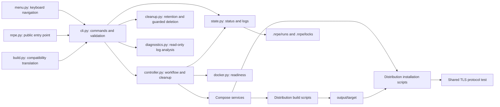
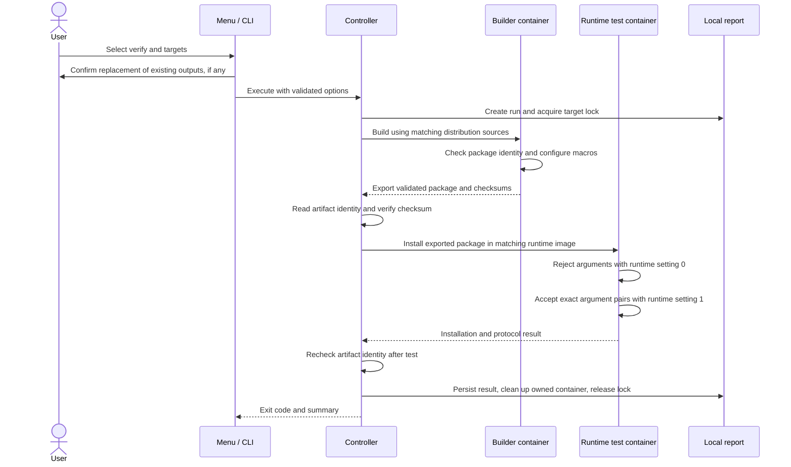

# Architecture and maintenance map

The host Python controller coordinates Docker Compose. Containers perform the
actual package work; target packages are never installed on the development host.
The optional terminal UI translates choices into the same CLI arguments used by
automation. It does not bypass target locks or artifact validation.

## Components

| File/module | Responsibility |
| --- | --- |
| `nrpe.py` | Public entry point; dispatches to `nrpe_cli.cli.main` |
| `build.py` | Compatibility wrapper for older commands; no separate build engine |
| `nrpe_cli/cli.py` | Parse commands, diagnose Compose, show status/logs, validate certificates and rebuild consent |
| `nrpe_cli/menu.py` | Optional terminal rendering, selection, directory browsing, and command review |
| `nrpe_cli/controller.py` | Sequence targets/phases, stream logs, persist outcomes, and clean up only the owned container |
| `nrpe_cli/docker.py` | Check Docker Engine, Linux container mode, and Compose; give platform-specific failure hints |
| `nrpe_cli/state.py` | Artifact identity/checksums, run IDs/reports, and per-target locks |
| `nrpe_cli/cleanup.py` | Preview/retention planning and guarded deletion of expired local evidence or explicitly selected project images |
| `nrpe_cli/diagnostics.py` | Classify build/download and NRPE runtime errors without executing or retaining log contents |
| `nrpe_cli/targets.py` | Shared target list and package filename conventions |
| `nrpe_cli/progress.py` | Optional context-local presentation events; controller owns execution and evidence |
| `nrpe_cli/certificates.py` | Validate public PEM/DER CA input and normalize it in memory for an environment-backed BuildKit secret |
| `nrpe_cli/release.py` | Validate exact workflow/build/source evidence and assemble complete release archives |
| `nrpe_cli/signing.py` | Validate complete release assets and sign/authenticate checksums with an enrolled maintainer key |
| `compose.yaml` / `compose.test.yaml` | Parameterized builder services and opt-in runtime test services |
| `docker/debian/build.Dockerfile` / `docker/debian/test.Dockerfile` | Debian build prerequisites and separate runtime environment |
| `docker/sles12sp3/build.Dockerfile` / `docker/sles12sp3/test.Dockerfile` | Genuine SP3 environments, verified prerequisites, and pinned original SLE-12 inputs |
| `packaging/*.json` and `*.asc` | Pinned SLES source/dependency manifests and verified signing-key identities |
| `output/<target>/` | Generated packages, checksums, and available provenance; not tracked |
| `.nrpe/` | Local reports, logs, and locks; not tracked |
| `website/` | Static presentation, shared-Markdown renderer, reviewed field notes and human-authored gh-pages publishing helper |

## A verify run

`build` stops before installation testing. `test` starts from existing artifacts
and checks those bytes, without establishing that they match the current source
checkout. Targets run sequentially within a command and the first failure stops
the remaining targets. Different target runs can proceed independently.

A pass is attached to the artifact's identity and SHA-256, including the SLES
user and matching client RPMs. Replacing any invalidates the matching result. Run reports
are local records, not cryptographically signed attestations. See the
[workflow reference](workflow.md#results-logs-and-concurrent-runs) for cleanup,
stale locks, and report limitations.

## Script responsibility review

All existing shell/Python scripts have active callers. The review retained the
package-format boundaries and the already-shared TLS protocol test. Shell is
used for native package tools; Python is used for structured metadata and narrow
source transformations. Download/source preparation uses a modern Python stage;
target compilation and installation use native SLES 12 tools without Python.

| Script | Caller | Why it remains separate |
| --- | --- | --- |
| `build.sh` | Debian builder entry point | APT source discovery, Debian changelog, `dpkg-buildpackage`, and export |
| `verify.sh` | `build.sh` | Check Debian package contents/identity and generated configure macros before export |
| `enable_command_args.py` | `build.sh` | Narrow, independently tested Debian rules transformation |
| `export_debian_sources.py` | `build.sh` | Validate the matching DSC and every referenced source archive before exporting corresponding sources |
| `prepare_release.py` | Release workflow / local candidate review | Host-only release staging, source/license validation and five-target completeness gate |
| `release_signature.py` | Release workflow / maintainer CLI | Restrict temporary signing-key access and dispatch optional signing/verification |
| `check_git_policy.py` / `delete_merged_topic.py` | PR workflows | Check integration/authorship policy and lease-delete only eligible merged topic heads |
| `setup-debian-repositories.sh` | Both Debian Dockerfiles | Shared source/binary setup and Bullseye archive adjustment |
| `integration-test.sh` | Debian test entry point | Debian artifact validation and installation, then shared protocol test |
| `build-sles.sh` | SLES builder entry point | Native RPM build, packaged defaults, and server/helper export |
| `build-sles-user.sh` | SLES builder image setup | Real independently packaged system user/group dependency; needed before NRPE build |
| `sles_source.py` | Modern SLES input preparation | Pinned source fetch/verification and appropriate recipe transformation |
| `prepare_sles_inputs.py` | Both SLES Dockerfiles' input stages | Prepare pinned downloads and metadata with optional in-memory company CA trust |
| `verify-sles-packages.sh` / `verify-sles-environment.sh` | Native SLES image stages | Validate real OS/ABI and all pinned RPM signatures and identities before installation |
| `fetch_sles_packages.py` | Modern input stage via `prepare_sles_inputs.py` | Download pinned inputs and validate size/hash; signature and identity checks have one native implementation in `verify-sles-packages.sh` |
| `integration-test-sles.sh` | SLES test entry point | RPM artifact/companion checks, dependency installation, then shared protocol test |
| `install-ca-certificate.sh` | Debian build and runtime Dockerfiles | Optional company CA setup, checksum validation, and distribution-specific system trust stores |
| `test-nrpe-protocol.sh` | Both integration entry points | Single TLS client/server test of disabled and enabled argument handling |

SLES 12 downloads are prepared separately, then verified and installed with the
native RPM implementation before any target code is built. `prepare_sles_inputs.py`
produces only pinned inputs, not target binaries. `verify-sles-packages.sh`
requires exact hash/signature/vendor/version coverage; `verify-sles-environment.sh`
checks the actual 12.3 identity and clean runtime base. The support-package build
creates genuine macros/user RPMs; no dependency provides are faked.

Terminal interaction lives in `menu.py`; workflow execution remains in the
controller. Server/companion checksums use one streaming helper in `state.py`,
with the manifest read once per artifact inspection. Native SLES signature and
identity verification lives in `verify-sles-packages.sh`; the unused Python
duplicate was removed. The legacy `build.py` remains a thin compatibility wrapper
for existing callers, without its own workflow engine.

## Images and updates

Builder images contain compilers and build requirements; runtime images contain
only test/runtime prerequisites. A successful fresh-container install therefore
cannot rely on a compiler or NRPE server preinstalled by the builder. Keeping two
roles is intentional even when both derive from the same distribution base.

Docker caches layers. `--pull` checks base images, while package-source updates
are a different concern: Debian discovers sources through APT at build time;
SLES uses explicitly reviewed pinned manifests. The controller does not yet
compare a complete remote source/recipe identity to decide whether existing
outputs need rebuilding. See [repeatability](workflow.md#repeatability-and-updates).
