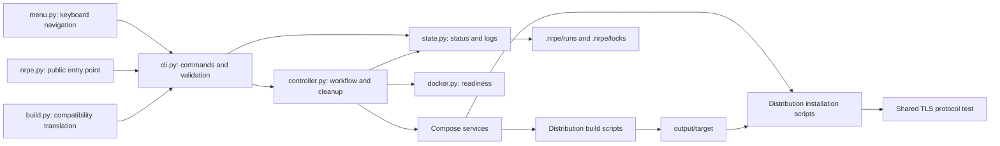
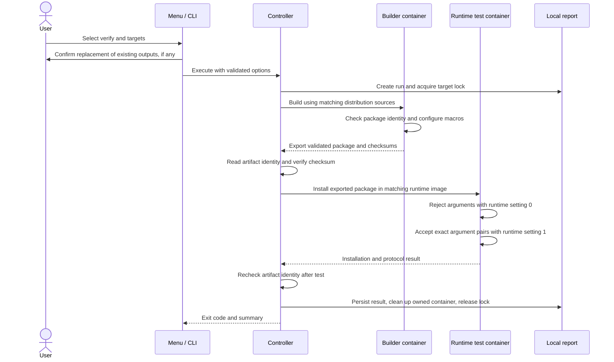

# Architecture and maintenance map

The host Python controller coordinates Docker Compose. Containers perform the
actual package work; target packages are never installed on the development host.
The optional terminal UI translates choices into the same CLI arguments used by
automation. It does not bypass target locks or artifact validation.

## Components

| File/module | Responsibility |
| --- | --- |
| `nrpe.py` | Public entry point; dispatches to `nrpe_cli.cli.main` |
| `build.py` | Compatibility wrapper for older commands; no separate build engine |
| `nrpe_cli/cli.py` | Parse commands, diagnose Compose, show status/logs, validate media and rebuild consent |
| `nrpe_cli/menu.py` | Optional terminal rendering, selection, directory browsing, and command review |
| `nrpe_cli/controller.py` | Sequence targets/phases, stream logs, persist outcomes, and clean up only the owned container |
| `nrpe_cli/docker.py` | Check Docker Engine, Linux container mode, and Compose; give platform-specific failure hints |
| `nrpe_cli/state.py` | Artifact identity/checksums, run IDs/reports, and per-target locks |
| `nrpe_cli/targets.py` | Shared target list and package filename conventions |
| `nrpe_cli/certificates.py` | Validate optional public PEM/DER CA input and prepare a temporary normalized BuildKit secret |
| `nrpe_cli/media.py` | Validate extracted SLES product identity, repository layout, and path containment |
| `compose.yaml` / `compose.test.yaml` | Parameterized builder services and opt-in runtime test services |
| `Dockerfile` / `Dockerfile.test` | Debian build prerequisites and separate runtime environment |
| `Dockerfile.sles` / `Dockerfile.sles-test` | Genuine SP4 environments, verified prerequisites, and read-only optional media |
| `packaging/*.json` and `*.asc` | Pinned SLES source/dependency manifests and verified signing-key identities |
| `output/<target>/` | Generated packages, checksums, and available provenance; not tracked |
| `.nrpe/` | Local reports, logs, and locks; not tracked |

## A verify run

`build` stops before installation testing. `test` starts from existing artifacts
and checks those bytes, without establishing that they match the current source
checkout. Targets run sequentially within a command and the first failure stops
the remaining targets. Different target runs can proceed independently.

A pass is attached to the artifact's identity and SHA-256, including the SLES
companion user RPM. Replacing either invalidates the matching result. Run reports
are local records, not cryptographically signed attestations. See the
[workflow reference](workflow.md#results-logs-and-concurrent-runs) for cleanup,
stale locks, and report limitations.

## Script responsibility review

All existing shell/Python scripts have active callers. The review retained the
package-format boundaries and the already-shared TLS protocol test. Shell is
used for native package tools; Python is used for structured metadata and narrow
source transformations. SLES container helpers must remain Python 3.6 compatible;
the host controller requires Python 3.9+.

| Script | Caller | Why it remains separate |
| --- | --- | --- |
| `build.sh` | Debian builder entry point | APT source discovery, Debian changelog, `dpkg-buildpackage`, and export |
| `verify.sh` | `build.sh` | Check Debian package contents/identity and generated configure macros before export |
| `enable_command_args.py` | `build.sh` | Narrow, independently tested Debian rules transformation |
| `setup-debian-repositories.sh` | Both Debian Dockerfiles | Shared source/binary setup and Bullseye archive adjustment |
| `integration-test.sh` | Debian test entry point | Debian artifact validation and installation, then shared protocol test |
| `build-sles.sh` | SLES builder entry point | Native RPM build, packaged defaults, and server/helper export |
| `build-sles-user.sh` | SLES builder image setup | Real independently packaged system user/group dependency; needed before NRPE build |
| `sles_source.py` | SLES Dockerfile and user-package builder | Pinned source fetch/verification and appropriate recipe transformation |
| `fetch_sles_packages.py` | Both SLES Dockerfiles | Verify original SUSE bootstrap RPM hashes, signatures, vendor, and identity |
| `setup-sles-repositories.sh` | Both SLES Dockerfiles | Shared SP4 repository setup and media-helper invocation |
| `setup-sles-media.sh` | SLES repository setup | Validate and register only approved product/module repositories when media is present |
| `integration-test-sles.sh` | SLES test entry point | RPM artifact/companion checks, dependency installation, then shared protocol test |
| `install-ca-certificate.sh` | All four Dockerfiles before network package operations | Optional company CA setup, checksum validation, and distribution-specific system trust stores |
| `test-nrpe-protocol.sh` | Both integration entry points | Single TLS client/server test of disabled and enabled argument handling |

Combining Debian and RPM installation or build scripts would introduce branching
around unrelated package managers and verification rules. Combining the two
SLES download helpers would mix source transformation with RPM signature policy.
The small repeated temporary-directory setup does not justify that coupling.
No package script was deleted or merged as part of this review.

The actual consolidation in this change is the host menu: the previous inline
number/text menu has been removed from `cli.py` and replaced by one frontend in
`menu.py`. Workflow execution remains solely in the controller. Repeated server/companion
checksum calculation is consolidated in one streaming helper in `state.py`,
with the checksum manifest read once per artifact inspection. The legacy
`build.py` remains a thin compatibility wrapper rather than being removed without
a deprecation process.

## Images and updates

Builder images contain compilers and build requirements; runtime images contain
only test/runtime prerequisites. A successful fresh-container install therefore
cannot rely on a compiler or NRPE server preinstalled by the builder. Keeping two
roles is intentional even when both derive from the same distribution base.

Docker caches layers. `--pull` checks base images, while package-source updates
are a different concern: Debian discovers sources through APT at build time;
SLES uses explicitly reviewed pinned manifests. The controller does not yet
compare a complete remote source/recipe identity to decide whether existing
outputs need rebuilding. See [repeatability](workflow.md#repeatability-and-updates).
