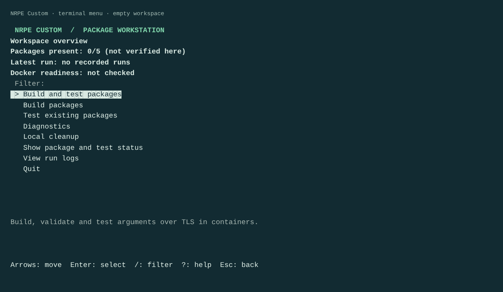

# Interactive terminal menu

The menu is an optional frontend to the same controller used by direct commands.
It does not implement separate build, locking, or cleanup behavior.

The workspace overview shows package presence, the latest recorded outcome and
Docker readiness from the last explicit check. It never checks Docker merely by
opening the menu, or treats package presence as a successful verification.



The screenshot is an actual prompt_toolkit render of an empty temporary workspace,
not evidence of a package build. Use direct commands for automation; see the
[CLI help capture](../website/assets/cli-help.png) for the command list.

## Install and start

From the repository root, install the pinned host-only dependencies:

```sh
python3 -m pip install -r requirements-menu.txt
python3 nrpe.py
```

If your Python installation is managed by the operating system, use a virtual
environment instead of overriding its package protections:

```sh
python3 -m venv .venv
```

Activate with `. .venv/bin/activate` on Linux/macOS, or
`.venv\Scripts\Activate.ps1` in PowerShell. Then run the installation command
above. The active interpreter must be available as `python3`. If a Windows
virtual environment does not provide that alias, use its explicit interpreter
`.venv\Scripts\python.exe` for both pip and `nrpe.py`, or configure a local
`python3` alias for it. No particular editor is required.

The menu uses prompt_toolkit for terminal input and rendering. This dependency
is not installed in build containers. Direct commands such as
`python3 nrpe.py verify debian12` continue to use only the Python standard library.

## Controls

| Key | Action |
| --- | --- |
| Up / Down | Move selection; long lists scroll |
| Home / End | Jump to the first / last item |
| Enter | Select an action or accept selected targets |
| Space | Toggle a target in the multi-selection screen |
| A | Select all currently visible targets, keeping previous selections |
| / | Start filtering labels and descriptions; type letters, including Q |
| Backspace | Edit the filter |
| Tab | Keep the filter and return to selection shortcuts |
| ? | Toggle contextual keyboard help |
| Escape / Q | Go back; Esc first closes help or clears an active filter; Q is literal text while filtering |
| Ctrl+C | Exit the menu; during a workflow, interrupt its command and clean up its container |
| Ctrl+D | End the menu at a selection prompt |

Selections and filtering are retained when returning to a directory or the
workspace. Long lists scroll to the highlighted entry; labels stay on one row
so a long path cannot consume the file list. Details provide contextual help.
Complete paths are available in a separate scrollable view.

During a workflow, the live panel shows the current controller phase, phase/run
elapsed time, per-target states and a bounded tail of recent output. No percentage
is guessed. Full Docker output is still written to the run log. Dispatch and
cancellation stay on the main thread; only rendering runs in a background thread.
The result screen offers target details, full logs and diagnosis of that run.

Inspection commands and full logs remain in terminal scrollback until Enter or
Esc returns to the menu. Logs are also available with `logs --run <id>`.

## Workflow

1. Choose build and test, build only, or test existing packages.
2. Select one or more named distributions with Space, then Enter. The first
   workflow has no selection; later workflows retain the session selection.
3. Choose whether to refresh base images for a build. Existing-package tests
   omit that build option. Optionally browse for a public PEM/DER company CA
   certificate, or enter/paste its path directly. Esc returns to targets.
4. Review the action, targets, base-image refresh, certificate path and output
   replacement. Cancel is selected by default; Back to options preserves all
   choices.
5. Select Run. Existing outputs are rebuilt only after this explicit confirmation.
6. Read the recorded per-target result, inspect full logs or explain a failure,
   then return to the workspace.

The certificate default follows `NRPE_CA_CERT`, if configured. The options show
whether the choice came from the environment, was selected manually, or was
explicitly disabled. Invalid environment defaults are validated before review.
"Do not use a company CA" overrides the environment for this session, without
changing it; direct commands can use `--no-ca-cert`. The CLI rejects combining
that option with `--ca-cert`. Choices are kept only in memory until the menu exits.

This CA trusts build downloads. It does not configure NRPE server/client
certificates or Docker Engine/registry trust.
See [company CA trust](network.md#optional-company-ca-certificate) for scope and image-cache details.

## Diagnostics and cleanup

Diagnostics checks Docker explicitly or explains a recorded/local log. For a
local file, choose build/download or NRPE context and state whether a build CA
was supplied. Diagnosis reads text; it never runs log content or changes TLS.
Runs are filterable by date/ID, target, action and outcome.

Local cleanup exposes retention age, number of runs to keep
and optional explicit project image tags. It uses the same planner and guards
as [the cleanup CLI](local-cleanup.md). Preview is read-only and remains visible
before a separate confirmation, with cancellation selected by default. Changed
candidates require another preview. There is no Docker-wide prune or forced
removal; current packages and retained evidence remain protected.

Diagnostics, status, and logs are available from the workspace.
A failed command returns to the menu after its result is acknowledged. Closing
the menu does not turn a failed workflow into a passed run: inspect its exit
message, report, or status. For automation, use direct commands and their exit
codes rather than the menu session's exit code.

## Enter or paste a path

The certificate browser includes **Enter or paste a path...**. A file selects
that certificate; a directory opens that location. A direct certificate-path
option is also available from the source menu.

Paste paths as plain text, for example `C:\Certificates\Company Root.cer`, or
with matching quotes as copied by Explorer's **Copy as path**. Backslashes and
spaces are preserved; paths are never evaluated as shell commands. `~` and
native environment-variable syntax are expanded (for example `%USERPROFILE%`
on Windows). Relative paths entered in a browser are relative to its current
directory; direct source-menu entry is relative to the process working directory.
Tab offers path completion. Enter accepts; Escape or an empty value cancels.
Cancelling returns to the existing browser location. Missing paths and incorrect
file/directory types show an error with options to retry or cancel. Certificate
contents still undergo regular validation.

## Many drives and long paths

Windows drive letters appear only in **Switch drive...**, not in every directory.
For twelve attached drives, the file list still contains just the current folder,
its navigation actions and eligible files. The separate drive selector is
scrollable and filterable with `/`; enumeration uses the OS drive mask without
probing every drive for labels, capacity or connectivity. Only the selected root
is opened. Unavailable roots show an error and retain the previous directory.

Cancelling drive selection retains the browser's folder, selection and scroll
position. Returning to a parent directory restores its highlighted entry. Use
**Show complete current path** for long paths or **Enter or paste a path...**
for direct drive/UNC access. Linux keeps ordinary directory/mount navigation.

## Terminal behavior

Use an interactive terminal on Windows, Linux, or macOS. `NO_COLOR` requests
monochrome rendering; selection remains visible through an arrow and reverse
video, rather than color alone. `TERM=dumb` also disables color, but a terminal
with cursor-control support is still needed for the menu. Use direct commands
for restricted terminals, screen-reader workflows where full-screen interfaces
are unsuitable, redirected output, and CI.

With no terminal attached, launching without arguments prints CLI help without
importing the optional dependencies or prompting. If a terminal is attached but
the dependencies are missing, the CLI prints the installation command.

## Validation limits for this revision

Keyboard/filtering/session-state tests, simulated 0/1/12-drive and unavailable-root
tests, and an actual Linux PTY cancellation exercise passed locally. The PTY
exercise used simulated build output to check main-thread interruption, retained
logs and lock release; it was not a real package build. Real Windows Terminal,
mapped/network drive and Docker Desktop scenarios remain not run here; use the
[practical validation checklist](practical-validation.md#windows-docker-desktop).
