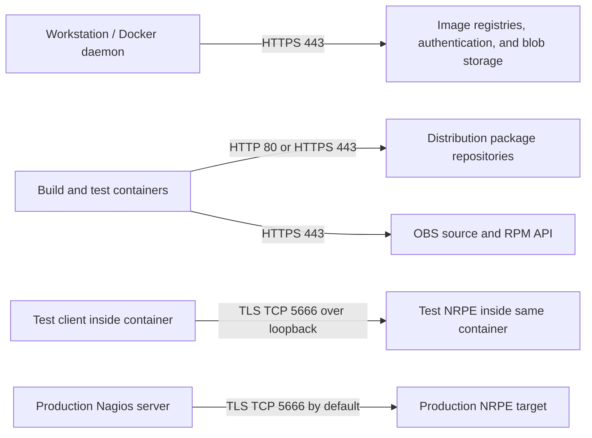

# Network and firewall requirements

Separate build-time downloads from production NRPE traffic. Builds require
outbound access, not an inbound NRPE port on the workstation. The default
integration test keeps both client and server inside one container over loopback.

## Connection map



## Outbound destination inventory

Prefer hostname-aware rules or an approved proxy/mirror. The following is a
starting inventory derived from the recipes, not an exhaustive static allowlist.
Registry/repository responses may redirect to other download hosts; resolve those
through your approved network policy. Do not disable TLS or signature checks to
work around a firewall rejection.

| Hosts | Ports | Used by | Purpose |
| --- | --- | --- | --- |
| `github.com` | TCP 443 | Git client | Clone/update this repository; GitHub releases if used later |
| `registry-1.docker.io`, `auth.docker.io` | TCP 443 | Docker/BuildKit | Official Debian base images and Dockerfile frontend image/authentication |
| `production.cloudflare.docker.com`, `production.cloudfront.docker.com` | TCP 443 | Docker/BuildKit | Possible Docker Hub blob/CDN destinations; actual endpoints may differ |
| `registry.suse.com` | TCP 443 | Docker/BuildKit | SLES SP4 BCI base image; follow authorized registry authentication/blob endpoints |
| `deb.debian.org`, `security.debian.org` | TCP 80 and/or 443, matching image APT sources | Debian containers | Package indexes, NRPE source, build and runtime dependencies |
| `archive.debian.org` | TCP 80 in the current Bullseye security rewrite | Debian 11 containers | Archived security packages; APT authenticity checks remain enabled |
| `download.opensuse.org` | TCP 443 plus approved mirror redirects | SLES containers | SP4 backports repository and package downloads |
| `updates.suse.com` | TCP 443 | SLES containers | Repository configured in the current SP4 BCI base; custom bases can differ |
| `api.opensuse.org` | TCP 443 | SLES builder and runtime-image setup | Pinned OBS sources, original SUSE bootstrap RPMs; authoritative signing keys during reviewed updates |
| `pypi.org`, `files.pythonhosted.org` | TCP 443 | Host pip, only when installing the optional menu | prompt_toolkit and wcwidth |
| `www.suse.com` and authorized SUSE download hosts | TCP 443 | Administrator, optional | Download official SP4 installation media; not needed by the standard online build |

SLES base-image repositories can add destinations such as `updates.suse.com`;
inspect `/etc/zypp/repos.d/` in the selected base for its actual URLs. A custom
`SLES_BASE_IMAGE`, RMT server, private registry, Docker registry mirror, or APT
configuration changes this list. Subscription-backed repositories may require
your own access entitlement; the controller does not supply one.

Configured DNS resolution is also required. Use your network's DNS resolver and
policy (commonly UDP/TCP 53); no particular public DNS service is required.
TLS environments may additionally require access to certificate-validation
services specified by their certificates and local policy.

### Why there is no fixed public IP list

These domains use CDNs, geographic mirrors, authentication services, and changing
A/AAAA records. An IP returned today can become incorrect or belong to a shared
service. GitHub's published IP ranges do not cover all registries and package
mirrors. A one-time DNS lookup is therefore not a durable or least-privilege rule.

If the firewall accepts only destination IPs, use an approved internal HTTP(S)
proxy or registry/package mirror with managed addresses. Allow clients to reach
that internal service, and maintain its external destinations centrally. Internal
IP addresses and credentials belong in site configuration, not this repository.

## Integration tests

- The client connects to `127.0.0.1:5666` inside the test container using TLS.
- No Compose service publishes this port to the Docker host.
- No incoming TCP 5666 rule is needed on the build workstation.
- The temporary configuration permits only loopback. It does not alter production
  `allowed_hosts`, certificates, or firewall rules.
- Test image creation and package installation still need the outbound package
  access described above, unless an approved cache/mirror supplies it.

## Production NRPE

| Source | Destination | Rule |
| --- | --- | --- |
| Explicit Nagios/poller IPs | NRPE target server | Allow TCP 5666 inbound on the target, or your configured `server_port` |
| NRPE target | Established monitoring connection | Permit return traffic through the stateful firewall |

Allow only the actual monitoring servers, including their effective source
address after NAT where applicable. Use those addresses in NRPE's `allowed_hosts`
and configure TLS authentication. NRPE does not normally initiate a new
connection back to Nagios. Additional connections required by individual check
plugins are deployment-specific and outside the protocol's port requirement.

The target server may separately need outbound package-repository access during
installation and updates. See [deployment security](security.md).

## Proxies and diagnosis

Docker image pulls, BuildKit downloads, host pip, and programs inside running
containers are separate clients. Configuring a host proxy alone does not prove
that every layer can reach its dependencies. Use supported Docker daemon/Desktop
proxy configuration and Docker client proxy/build configuration as appropriate.
For TLS inspection, install your organization's trusted CA in each affected
client/base image; preserve certificate verification.

`python3 nrpe.py doctor` checks local Docker readiness and Compose configuration.
It does not probe every remote repository. Inspect the failing phase's log with
`python3 nrpe.py logs --last` and your proxy/firewall logs to identify an actual
blocked hostname or redirect. Do not share unredacted authenticated URLs,
repository credentials, or complete proxy configuration files.

## Optional company CA certificate

If your organization inspects HTTPS traffic, the containers must trust the
organization's issuing CA. For errors such as `Curl error 60` / `self signed
certificate in certificate chain`, select the public root or intermediate CA
provided by your administrator:

```powershell
python3 nrpe.py verify sles15sp4 --ca-cert "C:\Certificates\Company-Root.cer"
python3 nrpe.py test debian12 --ca-cert "C:\Certificates\Company-Root.cer"
```

The option is supported by `build`, `test`, `verify`, and `build.py`, for every
target. The menu includes a certificate file browser under Workflow options.
Alternatively set `NRPE_CA_CERT` to the local file path; the explicit `--ca-cert`
option takes precedence. With neither configured, no extra CA is added.

Supply **one public X.509 certificate**, in PEM or DER format. `.cer`, `.crt`, and
`.pem` filenames are supported; the contents determine the format. Bundles and
private keys are rejected. This is a CA for repository HTTPS, not a production
NRPE client certificate or key. Keep your file outside the checkout, or under the
ignored `local-certificates/` directory. Do not commit company trust material.

The controller validates and normalizes the certificate into a per-run temporary
file, passes it as a BuildKit secret, and deletes the temporary file afterwards.
The normalized SHA-256 is passed separately to invalidate the image cache when
the certificate changes and is recorded in `report.json`; its contents are not
logged. Both builder and test images install the selected certificate in their
system trust stores **before** contacting repositories. Debian's minimal-image
bootstrap preserves existing roots until the regular CA package regenerates the
full trust database. TLS, APT/zypper signatures, and source checksums stay enabled.

The installed CA and generated trust database remain in local image layers,
including Docker caches. Do not publish company-specific builder/test images
without your organization's approval. The CA is not embedded into the exported
NRPE package. Run subsequent commands without the option/environment variable
to build images using only their default trust; existing cached images are not
modified in place.

The option configures container trust. It cannot fix registry pulls that fail
**before the Dockerfile runs**, because Docker Desktop/Engine and BuildKit use
separate trust stores. Configure those through your organization's Docker
instructions if required. Host pip/Git trust is also separate. Use `nrpe.py` to
prepare the secret and its cache identity; direct Compose commands do not
normalize DER input or calculate that identity for you.
